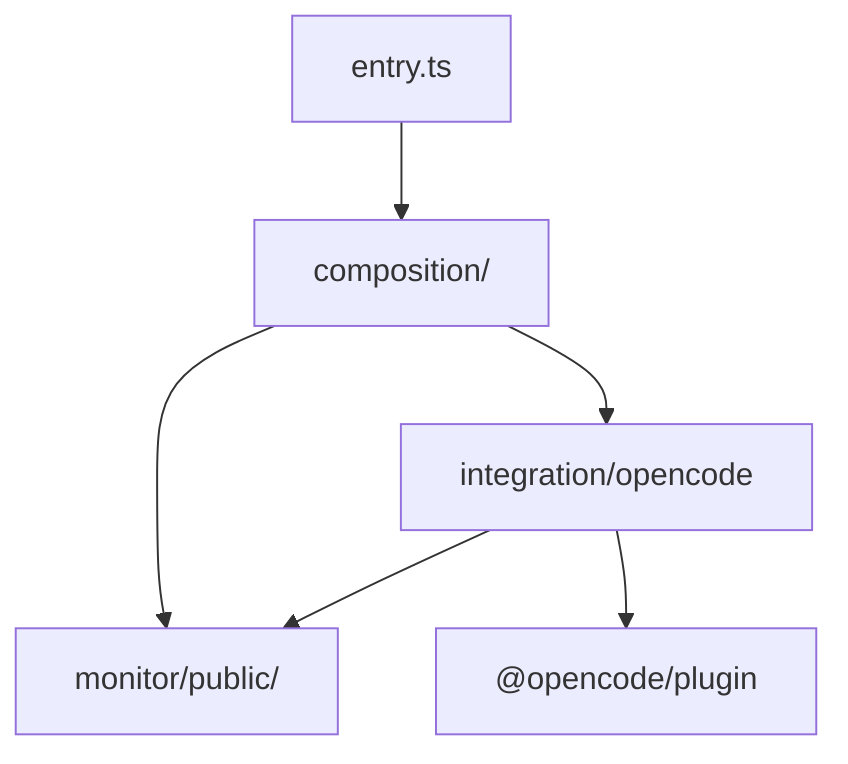

# Arquitetura do opencode-monitor

O opencode-monitor é um plugin server do OpenCode v2 que dá ao agente a ferramenta Monitor: um comando roda em segundo plano e cada linha relevante que ele imprime chega ao agente como mensagem sintética, sem ser prompt do usuário. O comportamento esperado está em [especificacao.md](especificacao.md).

O projeto segue as regras de `AGENTS.md` e de `docs/standards/` (legibilidade, tipagem, responsabilidade, desempenho) e a configuração do `biome.json`, trazidas do projeto Fenix (commit `1524d56`). Este documento adapta a arquitetura do Fenix e do Synapse a um plugin: mesmo padrão, em escala menor.

## Padrão arquitetural

Adota-se **monólito modular com Portas e Adaptadores (arquitetura hexagonal)**, organizado verticalmente por módulo:

- **Monólito modular:** um único pacote npm carregado pelo OpenCode. Os processos dos comandos monitorados continuam sob o controle do módulo que os criou.
- **Organização vertical:** código, adaptadores e testes de uma capacidade ficam no diretório do módulo responsável.
- **Portas e Adaptadores:** o módulo declara as operações externas de que precisa; a composição fornece as implementações. O módulo é desenvolvido e testado sem carregar o OpenCode.

O OpenCode continua dono das sessões, do histórico, das permissões e da entrega das mensagens. O plugin não guarda cópia dessas informações.

## Fronteiras

| Parte | Responsabilidade e estado exclusivos | Contrato na fronteira |
| --- | --- | --- |
| Módulo `monitor` | Monitores ativos, processos dos comandos, leitura das linhas, numeração e texto dos avisos, prazo de cada monitor | Recebe o pedido de início com a sessão, o comando, o rótulo e o diretório; devolve o monitor iniciado ou a falha ao iniciar. Exige a porta `NoticeSink`, que entrega um aviso à sessão |
| Integração `opencode` | Adaptação ao `@opencode/plugin`: definição das ferramentas e dos esquemas de entrada, pedido de permissão de shell, entrega por `session.synthetic` | Recebe o contexto do plugin e a interface do módulo; registra as ferramentas e implementa `NoticeSink` |
| Composição | Montagem e encerramento | Recebe o contexto do plugin; devolve a função de limpeza que o OpenCode chama ao descarregar o plugin |

O pedido de permissão é regra do host, não do módulo: a ferramenta pede a permissão de shell antes de chamar o módulo, e o módulo nunca executa um comando sem que isso tenha acontecido.

## Estrutura de diretórios

| Caminho | Conteúdo e propriedade |
| --- | --- |
| `src/modules/monitor/public/` | Contratos de entrada e saída, portas requeridas e ponto público de montagem do módulo |
| `src/modules/monitor/internal/` | Núcleo privado: registro dos monitores, numeração e texto dos avisos, entrega em ordem |
| `src/modules/monitor/adapters/` | Adaptadores privados: execução do comando num grupo de processos e leitura da saída |
| `src/modules/monitor/tests/` | Testes isolados do módulo e substitutos de suas portas |
| `src/integration/opencode/` | Ferramentas, esquemas de entrada, permissão e entrega pelo `@opencode/plugin` |
| `src/composition/` | Montagem, injeção do adaptador de entrega e encerramento |
| `src/entry.ts` | Entrada do pacote (`exports["."]`): declara o plugin com `Plugin.define` e aciona a composição |
| `tests/integration/` | Verificação do plugin montado contra um host substituto |
| `tests/fixtures/` | Host substituto e dados usados nos testes de integração |

`public/` separa os contratos, sem dependências concretas, do ponto de montagem que instancia a implementação privada. A composição usa esse ponto; não importa `internal/` nem `adapters/`.

Imports entre áreas usam o alias `#monitor/<área>`, resolvido pelo campo `imports` do `package.json` e pelo `paths` do `tsconfig.json`.

## Dependências permitidas

1. **O SDK do OpenCode (`@opencode/plugin`) fica em `integration/opencode/`.** A única exceção é `src/entry.ts`, que declara o plugin com `Plugin.define`. Objetos do SDK não atravessam os contratos do módulo.
2. **Só a composição e a integração acessam o módulo, sempre por `public/`.** O módulo não importa composição nem integração.
3. **O núcleo depende de contratos e portas, não de adaptadores.** A execução de processos é uma porta do núcleo implementada em `adapters/`; o ponto público de montagem liga os dois.
4. **Não há singletons mutáveis compartilhados.** Cada carga do plugin monta o seu registro de monitores e o encerra na limpeza.

## Contratos

- **Contexto explícito:** cada operação recebe a sessão e o diretório de que precisa. O módulo não consulta estado global do OpenCode.
- **Resultado explícito:** o início distingue monitor iniciado de falha ao iniciar, por união discriminada por `kind`.
- **Ciclo de vida:** a composição recebe o contexto do plugin e devolve a limpeza. O módulo para todos os processos que criou quando a limpeza é chamada.
- **Saída não confiável:** todo texto vindo do comando é escapado antes de virar aviso, e o aviso é marcado como não confiável.

## Suporte por sistema operacional

O plugin roda em macOS e Linux: os comandos rodam em `/bin/sh` e são parados pelo grupo de processos POSIX. Windows nativo está fora do escopo, conforme a especificação.

## Testes

- Os testes do módulo usam processos reais em `/bin/sh` e um substituto da porta `NoticeSink`.
- Os testes de integração montam o plugin pela composição contra um host substituto, que implementa só as partes do contexto que o plugin usa, e conferem a declaração do plugin pela entrada do pacote (`@davy121/opencode-monitor`).
- A validação no OpenCode real (aviso que acorda a sessão, rótulo na conversa) é manual e segue os critérios de aceite da especificação.
